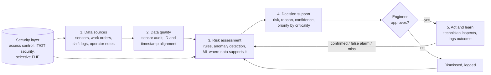
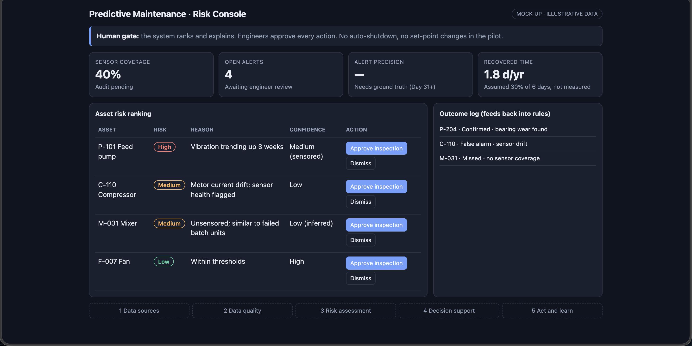

# Factory of 2036: Risk-First Predictive Maintenance

LYB Mumbai Hackathon 2026, Round 1 submission.

A human-supervised predictive maintenance system that turns unplanned downtime into planned intervention. It ranks asset risk, explains why, and leaves every decision to an engineer.

> **Status:** concept and mock-up. All data in the mock-up is illustrative.

## Why predictive maintenance

We compared it against inspection robots, AI vision quality, a digital twin and energy optimisation, and chose predictive maintenance because it is:

- **Proven:** a well-defined ML application with industrial track record.
- **Scalable:** sensor coverage can expand from the existing 40%, prioritising high-risk assets.
- **Able to cover unsensored machines:** usage patterns and batch-level failure history give risk estimates with stated uncertainty.
- **Measurable:** it targets preventable downtime and maintenance cost, and is piloted before scaling.

## Architecture



**Human gate:** no auto-shutdown and no set-point changes in the pilot.

### Roles

| Role | Responsibility |
|---|---|
| Reliability engineer | Approves action |
| Planner | Schedules inside a maintenance window |
| Technician | Inspects and logs the result |
| Operator | Reports observations |
| IT/OT owner | Data access and quality |

## Mock-up

`mockup.html` is a single-file dashboard mock-up (asset risk ranking, confidence labels, approve/dismiss gate, outcome log). Open it in a browser. Add a screenshot here once exported:

```md

```

## 90-day pilot plan

| Phase | Focus | Gate |
|---|---|---|
| Days 1-30 Baseline | Pick critical rotating assets, audit sensors, rebuild failure history, agree downtime definition | Downtime Pareto vs sensor coverage |
| Days 31-60 Shadow mode | Engineers review alerts, no autonomous action, no savings claimed from alerts alone | Is there enough warning, with spares and crews to act? |
| Days 61-90 Validate | Compare with baseline and inspection findings, re-estimate benefit with real plant inputs | Scale, refine or stop |

Funds are released in stages. A stop means re-scoping within the same option.

## Impact estimate (illustrative)

6 days of lost production x 30% prevented (assumed, not measured) = **1.8 days/yr**.

`payback = Rs 2 cr / net benefit`, where `net benefit = prevented days x value per day (+ verified repair costs) - running costs`.

Value per day, costs and prevention rate are not given, so no ROI is claimed. Cost-benefit sheet: see the submission appendix.

## Key risks

- **Weak data or poor transfer between dissimilar assets** leads to false alarms and misses, then lost trust. Mitigation: data checks, confidence labels, per-asset validation, human review, go/no-go gates.
- **Sensors may not sit on the assets causing downtime.** Mitigation: the Day 1-30 Pareto overlay decides whether to start with existing data or instrument top-ranked assets.

## Suggested stack (not fixed)

The design is technology-neutral. A reasonable starting point:

- Python, pandas, scikit-learn for rules and anomaly detection
- A time-series store (TimescaleDB or InfluxDB) for sensor data
- A simple web UI (React or the HTML mock-up) for the engineer console

## Repo layout

```
.
├── README.md
├── mockup.html
├── docs/
│   └── mockup.png
└── src/            # to be built
```

## Roadmap

- [ ] Export mock-up screenshot to `docs/`
- [ ] Synthetic sensor and work-order dataset
- [ ] Rule-based risk scoring baseline
- [ ] Anomaly detection on sensored assets
- [ ] Risk estimates for unsensored assets, with uncertainty
- [ ] Engineer approval workflow and outcome logging

## Team

Add team name, members and contact here.

## AI disclosure

Generative AI assisted drafting, structure and design. The team owns all assumptions, calculations and recommendations.
