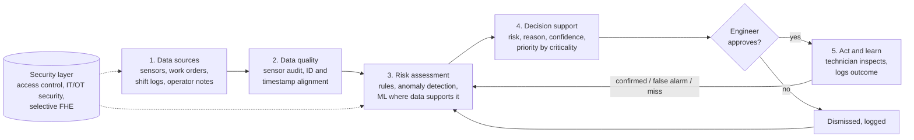

<div align="center">

<a href="https://htmlpreview.github.io/?https://github.com/Frostwave-afk/LYB-Factory-of-2036/blob/main/Predictive%20Maintenance%20Risk%20Console%20Mock-up.html">
  
</a>

<br>


**[▶ Open the live mock-up](https://htmlpreview.github.io/?https://github.com/Frostwave-afk/LYB-Factory-of-2036/blob/main/Predictive%20Maintenance%20Risk%20Console%20Mock-up.html)**
&nbsp;·&nbsp; [Why this bet](#why-predictive-maintenance) &nbsp;·&nbsp; [Console](#the-console) &nbsp;·&nbsp; [Architecture](#architecture) &nbsp;·&nbsp; [Sensor gap](#the-sensor-gap) &nbsp;·&nbsp; [90-day pilot](#the-90-day-pilot) &nbsp;·&nbsp; [Impact](#impact-honestly-estimated) &nbsp;·&nbsp; [Risks](#key-risks)

</div>
> [!NOTE]
> **AI use disclosure.** The ideas, decisions, assumptions, calculations and recommendations in this project are the team's own. We used AI (Claude by Anthropic) to arrange the slide layout, rephrase some of our text, and draft this README and its animated visuals. We reviewed all of it and take responsibility for its content.

> [!CAUTION]
> **Concept and mock-up only.** All numbers are illustrative, and the "live" signals, statuses and replays on this page are simulated, not real plant data. The 1.8 days/yr figure rests on an assumed 30% prevention rate and is not a measured result.
<br>

> **In one line:** a predictive maintenance system that ranks which machine is most likely to hurt you next, says *why*, says *how sure it is*, and then **hands the decision to an engineer**. It never shuts anything down by itself.

Built by **Code Crusaders** (NMIMS Mukesh Patel) for the **LYB Mumbai Hackathon 2026, Round 1**. Everything on this page is a concept and a mock-up; **all numbers in the mock-up are illustrative**.


## The problem

The brief describes a plant that is **losing about six days of production**, has sensors on only **40% of its assets**, keeps **incomplete maintenance records**, runs **ageing equipment**, and depends on experienced technicians whose knowledge isn't written down.

The question we answered: *if you could fund one thing, what turns unplanned downtime into planned intervention?*


## Why predictive maintenance

We weighed five options against the plant's real pressures and funded **one**.

| Option | Verdict | Why |
|---|---|---|
| **Predictive maintenance** | ✅ **Funded** | Proven ML application with industrial track record. Starts on the 40% of assets that are sensored, extends selectively to high-risk assets, and can estimate risk for *unsensored* machines from usage and batch-level failure history (with stated uncertainty). Measurable: it targets preventable downtime and maintenance cost, and is piloted before it scales. |
| Energy optimisation | Strongest rival | Largest controllable cost, but savings are unquantified because of ageing equipment, and set-point changes could disrupt process stability. Safe savings need validation first. |
| Inspection robots | Not now | High cost, certification burden and deployment complexity. Human exposure may remain anyway. |
| Digital twin | Not now | At least 3 years to start giving ROI, and set-point changes are difficult and expensive to handle. Experts can get similar or better results from passive data. |
| AI vision quality | Not now | Current defect losses are low, which caps near-term upside. A person can do this task, and new hires are an option. |

<details>
<summary><b>Assumptions this bet rests on</b> (each one is tested in the pilot)</summary>

<br>

| # | Assumption | Tested in |
|---|---|---|
| 1 | A meaningful share of breakdown downtime is preventable by earlier detection | Days 61–90 |
| 2 | Critical assets can be ranked from engineering judgement, history and a downtime Pareto | Days 1–30 |
| 3 | Failure modes give enough warning, and maintenance windows, spares and crews exist to act on it | Days 31–60 |
| 4 | The sensors that are installed sit on equipment that needs maintenance and produce data useful for predicting it | Days 1–30 |

</details>


## The console

This is the engineer's view. The animation below is a replay of the real mock-up in this repo: a cursor works through four ranked assets, the **open alerts** counter drops from 4 to 0, and every decision lands in the **outcome log** that feeds back into the rules.

<div align="center">
  
</div>

<br>

Every alert carries four things, so nobody has to trust a black box:

| Field | Example from the mock-up |
|---|---|
| **Risk** | `High`, `Medium`, `Low` |
| **Reason** | *Vibration trending up 3 weeks* · *Motor current drift; sensor health flagged* |
| **Confidence** | `Medium (sensored)` · `Low (inferred)` for unsensored machines |
| **Action** | **Approve inspection** or **Dismiss**, by an engineer |

The outcome log is where the system learns. `P-204 · Confirmed · bearing wear found`, `C-110 · False alarm · sensor drift` and `M-031 · Missed · no sensor coverage` are all kept, because **misses and false alarms are the most useful data the pilot produces**.

**Try it yourself:** [open the live mock-up](https://htmlpreview.github.io/?https://github.com/Frostwave-afk/LYB-Factory-of-2036/blob/main/Predictive%20Maintenance%20Risk%20Console%20Mock-up.html), or download `Predictive Maintenance Risk Console Mock-up.html` and open it in any browser. It is one file with no dependencies and follows your light or dark theme.


## Architecture

Five stages, one human gate, one feedback loop. Watch a signal travel through, stop at the gate until an engineer approves, then come back around to tune the rules.

<div align="center">
  
</div>

<br>

> **Human gate:** no auto-shutdown, no set-point changes, no overriding safety systems. In the pilot, the system ranks and explains. **Engineers decide.**

### What each stage does

| Stage | What happens |
|---|---|
| **1. Data sources** | Sensored assets (the stated 40%; example signals such as vibration, temperature and motor current are *not confirmed*), plus work orders, shift logs and operator notes. |
| **2. Data quality** | Audit sensor health, gaps and calibration. Align timestamps and asset IDs. Tag confidence. Rebuild failure history from records. |
| **3. Risk assessment** | Engineering rules and thresholds **first**. Anomaly detection where signals suit it. ML only where the data supports it. |
| **4. Decision support** | Risk level, reason and confidence, with a suggested inspection, prioritised by criticality. |
| **5. Act and learn** | Engineer approves, technician inspects, result is logged as *confirmed*, *false alarm* or *miss*. Results tune the rules and models. |

### Where AI is used, and where it isn't

| Used | Deliberately not used |
|---|---|
| Anomaly detection and risk ranking on sensored assets | Shutting equipment down |
| Risk **estimates** for unsensored machines, from usage and batch history, *with uncertainty* | Changing set-points or overriding safety systems |
| Reading work orders and notes to rebuild failure history | Approving maintenance (engineers decide) |
| Flagging sensor drift | Claiming certainty on unsensored assets |

**Why rules first?** There are few labelled failures, so machine learning alone would be guessing. And any AI has to beat what better inspection rounds would achieve anyway.

### Who does what

| Role | Responsibility |
|---|---|
| Reliability engineer | Approves action |
| Planner | Schedules inside a maintenance window |
| Technician | Inspects and logs the result |
| Operator | Reports observations |
| IT/OT owner | Data access and quality |

### Security layer

**Fully Homomorphic Encryption (FHE)** lets analytics run on *encrypted* sensor and maintenance data, so raw plant data stays protected when shared with a cloud or external partners. Because FHE is compute-heavy, it is used **selectively**, alongside normal access control and IT/OT security. It is a supporting safeguard, not the core of the design.

<details>
<summary><b>Prefer a static, text-searchable diagram?</b></summary>

<br>



</details>


## The sensor gap

Only 40% of assets have sensors, and **nothing guarantees those are the assets that cause downtime**. So before modelling anything, the first gate of the pilot overlays the downtime Pareto on sensor coverage.

<div align="center">
  
</div>

<br>

*The grid is an illustration of the method, not plant data.* The outcome of that overlay decides the path:

- **Sensors are on the critical assets** → start with existing data.
- **They aren't** → quote and instrument the top-ranked assets first, or run on thresholds and inspection rounds, clearly labelled **low confidence**. Extend the baseline once, no more.
- **Records are thin** → rebuild failure history from work orders and interviews, and adopt failure codes going forward.
- **Sensors are unreliable** → repair or calibrate before adding any. New sensors only where the decision value justifies the cost (quote pending).


## The 90-day pilot

Prove the value before scaling. Funds are released in stages, and each phase **tests one of the four assumptions** with a pre-agreed pass/fail gate.

<div align="center">
  
</div>

<br>

| Phase | Do | Gate (and what happens if it fails) |
|---|---|---|
| **Days 1–30 · Baseline** | Pick critical rotating assets. Audit sensors, rebuild failure history. Agree the downtime definition, costs and thresholds. | **Downtime Pareto vs sensor coverage.** *Fail →* instrument top-ranked assets (quote first) or run on thresholds and inspection rounds. |
| **Days 31–60 · Shadow mode** | **No autonomous action.** Engineers review alerts. Existing reliable sensors first; targeted additions only if justified. **No savings claimed from alerts alone.** | **Enough warning, spares and crews to act?** *Fail →* move to assets with longer warning, fix spares and crew planning, or drop assets we can't act on. |
| **Days 61–90 · Validate and decide** | Compare against baseline and inspection findings. Measure precision, false-alert hours, adoption, data reliability. Re-estimate benefit with real plant inputs. | **Scale, refine or stop.** *Fail →* stop, or re-scope to the failure modes that *are* detectable. Later funds are never released. |

**Pilot metrics:** alert precision (where ground truth exists), false-alert rate and investigation hours, inspection-confirmed alerts, actionable interventions, data completeness, and estimated net annual benefit from *verified* inputs.

> **Scale only if** data quality, usefulness, safety and the business case meet criteria agreed **beforehand** (thresholds to be ratified with plant engineering). A stop means re-scoping within the same option, not abandoning the plan.


## Impact, honestly estimated

We are deliberately **not claiming an ROI**, because the inputs that decide it were not given.

<div align="center">
  
</div>

<br>

| | |
|---|---|
| **Recovered time** | 6 days × 30% prevented = **1.8 days/yr**. The 30% is a *scenario assumption*, not a measurement. |
| **In hours** | 1.8 × 24 h = 43.2 h ≈ **0.49%** of 8,760 calendar hours. The brief does not define what a "day" means, so this is stated, not hidden. |
| **Net benefit** | prevented days × value per day (+ verified repair costs) − running costs |
| **Payback** | ₹2 cr ÷ net benefit |
| **Not given** | Value per day, running costs, true prevention rate. **To be collected in the baseline phase.** |

<details>
<summary><b>Why 90 days can't prove a cut in downtime</b></summary>

<br>

Ninety days is about **1.5 days** of baseline downtime. That is far too little to demonstrate a statistically meaningful reduction, so the pilot is judged on **leading indicators** (precision, false-alert hours, adoption, data reliability) rather than on downtime saved.

When real numbers exist, the break-even is:

```
break-even prevented days = (₹2 cr ÷ target payback years + annual running cost) ÷ value per day
```

The full cost-benefit workings are in the [cost-benefit spreadsheet](https://docs.google.com/spreadsheets/d/1AR225Rt7ZvWvy6uKJ0X3sX2VxL1rx2ZB/edit?usp=sharing).

</details>


## Key risks

| Risk | What we do about it |
|---|---|
| **Biggest failure mode: weak data, or poor transfer between dissimilar assets.** Extrapolating from thin data can mean a high error rate with ML methods, then false alarms, misses and lost trust. | Set the right baseline, tag confidence on every alert, validate per asset, and keep a human in the loop. Go/no-go gates at every phase. |
| **Sensors may not sit on the assets causing downtime.** | The Day 1–30 Pareto overlay decides whether to start with existing data or instrument top-ranked assets. |
| **Most critical assumption: that a meaningful share of downtime is preventable *and* detectable early enough to act.** If wrong, the result is false alarms, missed failures and cost with no recovered production. | Tested in Days 61–90. If it fails, pause, re-scope or stop. Funds are released in stages, so a wrong assumption is cheap to find. |
| **Unsensored assets get over-trusted.** | Risk is always labelled `Low (inferred)` with uncertainty. Criticality ranking, thresholds and inspection rounds cover them. |


## Suggested stack

The design is technology-neutral and nothing here is fixed. A reasonable starting point:

| Layer | Option |
|---|---|
| Rules and anomaly detection | Python, pandas, scikit-learn |
| Sensor time-series | TimescaleDB or InfluxDB |
| Engineer console | React, or the single-file HTML mock-up in this repo |

## Repo layout

```
.
├── README.md
├── Predictive Maintenance Risk Console Mock-up.html   # the interactive mock-up
├── assets/                                            # animated SVGs used on this page
│   ├── hero.svg
│   ├── live-console.svg
│   ├── architecture.svg
│   ├── coverage.svg
│   ├── pilot-timeline.svg
│   ├── impact.svg
│   └── divider.svg
└── src/                                               # to be built
```

## Roadmap

- [x] Interactive risk console mock-up (ranking, confidence, approve/dismiss gate, outcome log)
- [x] Architecture, pilot plan and impact framing
- [ ] Synthetic sensor and work-order dataset
- [ ] Rule-based risk scoring baseline
- [ ] Anomaly detection on sensored assets
- [ ] Risk estimates for unsensored assets, with uncertainty
- [ ] Engineer approval workflow and outcome logging


## Team

**Code Crusaders** · NMIMS Mukesh Patel

Yug Rokadia &nbsp;·&nbsp; Jash Khatri

## Use of AI

Generative AI assisted with drafting, structure and layout of the submission, and with creating the animated visuals on this page. **The team owns all ideas, assumptions, calculations and recommendations.**

<details>
<summary><b>About the animated visuals</b></summary>

<br>

The animations in `assets/` are plain SVG (SMIL), with no JavaScript, no external requests and no tracking, about 90 KB in total. GitHub renders them inline from the repo. Each has a text description for screen readers, and the colours match the mock-up's own palette. The "live" signals, statuses and replays are **simulated** to illustrate the design; none of it is real plant data.

</details>

<div align="center">
  <sub>Factory of 2036 · LYB Mumbai Hackathon 2026 · Round 1</sub>
</div>
